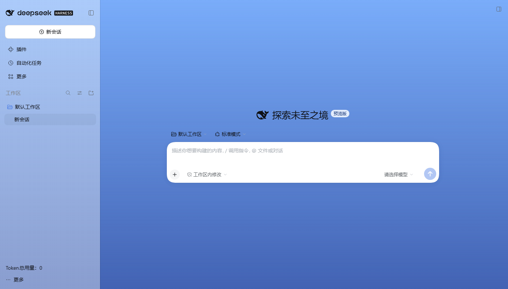
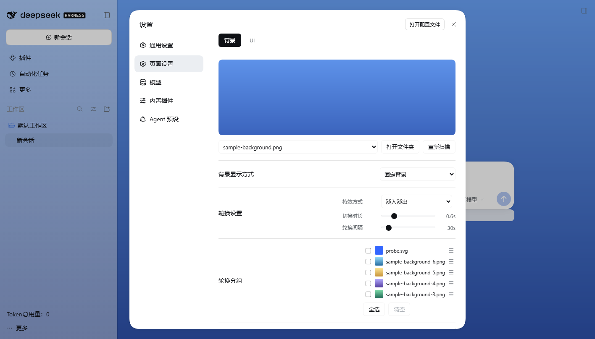

# dsh-chat-background

> A visual background plugin for [DeepSeek Harness](https://github.com/deepseek-ai/deepseek-harness) (DSH) desktop:
> wallpaper, independent scrims for the three columns, background rotation with groups, a bar under the composer,
> a task progress bar and an all-session token total — all configured in **Settings → Page settings**.

[](https://github.com/LittleLemonJam/dsh-chat-background/actions/workflows/ci.yml)
[](LICENSE)



## What it does

Pick a few pictures, put them in the background folder (default `~/.dsh/backgrounds/`, created automatically if
missing), and the chat window gets a wallpaper. Keep one image fixed or rotate through a group of favourites; tune the
left sidebar, main window, text card and right sidebar scrims separately (optionally with separate light/dark values) so text stays readable. The plugin also adds a bar under
the input, a task progress bar and a total token usage line.

## Features

| Feature         | Description                                                                                                                                                          |
| --------------- | -------------------------------------------------------------------------------------------------------------------------------------------------------------------- |
| Chat background | Picks an image from the background folder and paints it across the app. png / apng / jpg / jpeg / webp / gif / avif / bmp / svg; GIF, animated WebP and APNG animate |
| Rotation        | Keep one image fixed or rotate automatically every 5–300 seconds                                                                                                     |
| Transition      | Fade, fade-through or none; duration 0–3 seconds                                                                                                                     |
| Rotation group  | Rotate only checked images; thumbnails, a five-row scrollable list and drag reordering that never changes on selection                                               |
| Four scrims     | Independent 0–100 opacity for the left sidebar, main window, text card and right sidebar; optional separate light/dark values                                        |
| Composer bar    | A bar as wide as the input wrapping the usage row, with a configurable colour                                                                                        |
| Task progress   | Todo completion when available, a step estimate while running, hidden when idle                                                                                      |
| Total tokens    | All-session (archived included) token usage above the account row, adjustable font size                                                                              |
| Image zoom      | Wheel zoom in the chat image lightbox and right-sidebar preview; double-click resets the lightbox                                                                    |



## Install

Requirement: DSH desktop **≥ 0.2.2-rc.1**. Node ≥ 22.19 is only needed to build and test from source.

### From GitHub (recommended)

```bash
dsh plugin --profile desktop add github:LittleLemonJam/dsh-chat-background
```

Fully quit and reopen DSH afterwards — the host half loads at boot; refreshing the page is not enough.
Check **Plugins → Installed** to confirm `dsh-chat-background` is enabled.

### From npm

```bash
dsh plugin --profile desktop add dsh-chat-background
```

The npm package tracks the GitHub release (currently `1.1.1`); either channel works.

### Manual install

1. Copy `package.json`, `index.js`, `host/`, `client.js`, `cordis.patch.yml`, `locale/` and `icon.svg` into
   `~/.dsh/profiles/desktop/node_modules/dsh-chat-background/`;
2. Add `"dsh-chat-background": "file:./node_modules/dsh-chat-background"` to the profile's `dependencies` and
   `dsh-chat-background` to `dsh.profile.bundles`;
3. Add the following to the profile's `cordis.patch.yml`:

   ```yaml
   - insert:
       - id: chat-background
         name: 'dsh-chat-background'
   ```

4. Restart DSH.

### Where pictures go

Pictures live in `~/.dsh/backgrounds/` (`C:\Users\<you>\.dsh\backgrounds\` on Windows; set `DSH_BACKGROUNDS_DIR` to use
another folder). **You do not need to create the folder first** — opening the settings page or pressing **Open folder**
creates it automatically. Drop images in, then press **Rescan** under **Settings → Page settings → Background**.

## Usage

- **Fixed / rotation**: choose the display mode under the image picker. Rotation uses the checked images in the
  rotation group; if nothing is checked, the whole library is used.
- **Progress**: exact when the agent keeps a todo list; otherwise estimated from this turn's steps (capped at 92%);
  hidden while idle.
- **Tokens**: totals across all sessions (archived included), cached for 10 seconds and refreshed once a minute.
- **Themes and scrims**: light/dark themes adapt automatically. A 100% scrim is fully opaque; 0% shows the wallpaper.
- **Right-sidebar full screen**: the left sidebar stays visible while the main window and the original right sidebar
  become the right sidebar content; exiting restores the layout.

## Compatibility

| Item             | Value                                |
| ---------------- | ------------------------------------ |
| Verified DSH     | `0.2.2-rc.1` (Electron 44 / Node 24) |
| DSH requirement  | `>=0.2.2-rc.1`                       |
| Node requirement | `^22.19.0 \|\| >=24.0.0`             |
| Platforms        | Windows / macOS / Linux desktop      |

When the GUI is opened through a non-loopback address (reverse proxy or remote access), the image and token routes are
rejected by the request fence by default; set `DSH_CHAT_BACKGROUND_ALLOWED_HOSTS=<your-host>` for a trusted proxy.

## Security and privacy

- Reads only the background folder and local session projections; no internet requests and no credentials;
- HTTP routes are loopback-only with Host / Origin / Fetch metadata checks;
- SVG is served with a sandbox CSP, so opening it directly cannot run scripts;
- File names, image size, directory scan count and session file size are all bounded.

See [SECURITY.md](SECURITY.md) for details.

## Development

```bash
npm install
npm run build        # src/ → client.js (commit the bundle)
npm run check        # manifest, locale, build freshness, encoding/i18n checks
npm run test:unit    # unit tests
npm run test:e2e     # isolated end-to-end suite (requires a local DSH install)
npm run verify       # format:check + build + check + test:unit
```

See the [development guide](docs/DEVELOPMENT.md), [architecture](docs/ARCHITECTURE.md) and
[testing guide](docs/TESTING.md).

## Publishing

See the [publishing guide](docs/PUBLISHING.md) for GitHub, npm and plugin-market steps.

## License

[MIT](LICENSE) © 2026 LittleLemonJam
