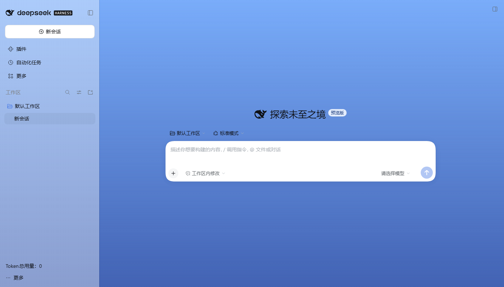
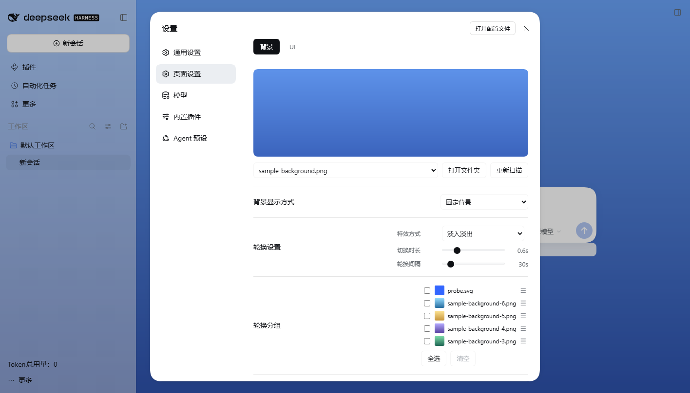

# dsh-chat-background

> 给 [DeepSeek Harness](https://github.com/deepseek-ai/deepseek-harness)（DSH）桌面端换一张好看的背景：
> 聊天背景图、三栏独立遮罩、背景轮换与分组、输入栏背景条、任务进度条、Token 总用量，全部在「设置 → 页面设置」里调整。

[](https://github.com/LittleLemonJam/dsh-chat-background/actions/workflows/ci.yml)
[](LICENSE)



## 简介

这是一个本地运行的 DSH 插件。选几张喜欢的图片放进背景文件夹（默认 `~/.dsh/backgrounds/`，不存在会自动创建），
就能让聊天界面拥有自己的壁纸：可以固定一张，也可以按间隔自动轮换；左侧栏、主窗口、文字框、右侧栏的遮罩深浅可以分别调，还能让浅色/深色主题各存一套，界面文字仍然清楚可读。
另外还附带输入栏背景条、任务进度条和全会话 Token 用量等小工具。

## 功能

| 功能         | 说明                                                                                                                    |
| ------------ | ----------------------------------------------------------------------------------------------------------------------- |
| 聊天背景     | 从背景文件夹选图铺满界面；支持 png / apng / jpg / jpeg / webp / gif / avif / bmp / svg，GIF、动画 WebP、APNG 会播放动画 |
| 背景轮换     | 固定一张或自动轮换；轮换间隔 5–300 秒                                                                                   |
| 切换特效     | 淡入淡出、渐变过渡、无；时长 0–3 秒                                                                                     |
| 轮换分组     | 只轮换勾选的图片；缩略图、5 行滚动列表、拖动排序，勾选不改变顺序                                                        |
| 四层遮罩     | 左侧栏 / 主窗口 / 文字框 / 右侧栏分别设置 0–100 遮罩不透明度；可让浅色、深色主题分别保存                                |
| 背景条       | 输入栏下方一条等宽背景条，包住用量数据，可自定义颜色                                                                    |
| 任务进度条   | 有任务清单时显示完成度，执行中按步数估算，空闲时隐藏                                                                    |
| Token 总用量 | 左下角显示所有会话（含已归档）的累计 token 用量，可调字号                                                               |
| 图片滚轮缩放 | 聊天图片灯箱、右侧栏图片预览可滚轮缩放；灯箱双击还原                                                                    |



## 安装

前置：DSH 桌面端 **≥ 0.2.1-rc.3**。Node ≥ 22.19 只用于从源码构建和测试，普通安装不需要。

### 从 GitHub 安装（推荐）

```bash
dsh plugin --profile desktop add github:LittleLemonJam/dsh-chat-background
```

安装后**完全退出并重新打开** DSH 桌面端（宿主半在启动时加载，只刷新页面不够）。
可以在 **插件 → 已安装** 里确认 `dsh-chat-background` 处于启用状态。

### 从 npm 安装

```bash
dsh plugin --profile desktop add dsh-chat-background
```

npm 包与 GitHub 发布同步（当前 `1.1.0`），两条安装方式任选其一即可。

### 手动安装

1. 把仓库（或 `npm pack` 解压后）的 `package.json`、`index.js`、`host/`、`client.js`、`cordis.patch.yml`、
   `locale/`、`icon.svg` 放进 `~/.dsh/profiles/desktop/node_modules/dsh-chat-background/`；
2. 在 profile 的 `package.json` 的 `dependencies` 加入
   `"dsh-chat-background": "file:./node_modules/dsh-chat-background"`，并把 `dsh-chat-background` 加入
   `dsh.profile.bundles`；
3. 在 profile 的 `cordis.patch.yml` 追加：

   ```yaml
   - insert:
       - id: chat-background
         name: 'dsh-chat-background'
   ```

4. 重启 DSH。

### 背景图放在哪里

图片固定放在 `~/.dsh/backgrounds/`（Windows 为 `C:\Users\<用户名>\.dsh\backgrounds\`；也可以用环境变量
`DSH_BACKGROUNDS_DIR` 指向其他目录）。**目录不存在不用手动创建**：第一次打开设置页或点「打开文件夹」时插件会自动建好。
把图片放进去后，在 **设置 → 页面设置 → 背景** 点「重新扫描」即可看到。

## 使用

- **固定/轮换**：在「背景显示方式」里选择；轮换时只使用「轮换分组」里勾选的图片，全部不勾选则使用整个背景库。
- **进度条**：agent 有任务清单时按「已完成 / 总数」显示；没有清单但正在执行时按本轮步数估算，最高 92%；空闲时隐藏。
- **Token 总用量**：汇总所有会话（含已归档）的 token 用量，每 10 秒缓存、每分钟刷新；数据只在本机读取。
- **主题与遮罩**：浅色/深色自动适配；遮罩调到 100 时该区域完全不透明，调到 0 时完全显示背景。
- **右侧栏全屏**：全屏预览时左侧栏保持可见，主窗口与原右栏变为右栏内容；退出后恢复原布局。

## 兼容性

| 项            | 值                                    |
| ------------- | ------------------------------------- |
| 已验证 DSH    | `0.2.1-rc.3`（Electron 44 / Node 24） |
| DSH 版本要求  | `>=0.2.1-rc.3`                        |
| Node 版本要求 | `^22.19.0 \|\| >=24.0.0`              |
| 支持平台      | Windows / macOS / Linux 桌面端        |

通过**非回环地址**（反向代理或远程访问）打开 GUI 时，图片与 Token 路由默认会被请求栅栏拒绝；请设置
`DSH_CHAT_BACKGROUND_ALLOWED_HOSTS=<你的主机名>`（仅限可信代理）后再使用。

## 安全与隐私

- 只读取背景文件夹和本机会话投影，不访问互联网、不读取凭据；
- 所有 HTTP 路由只监听本机回环地址，并校验 Host / Origin / Fetch 元数据；
- SVG 以沙箱 CSP 提供，顶层打开也不会执行脚本；
- 文件名、图片大小、目录扫描数量和会话文件大小都有上限。

细节见 [SECURITY.md](SECURITY.md)。

## 开发

```bash
npm install
npm run build        # src/ → client.js（提交构建产物）
npm run check        # 清单、locale、构建产物、编码/i18n 检查
npm run test:unit    # 单元测试
npm run test:e2e     # 隔离实例的端到端测试（需要本机 DSH）
npm run verify       # format:check + build + check + test:unit
```

仓库结构、热更新规则与调试方法见 [开发指南](docs/DEVELOPMENT.md)；
实现与不变量见 [架构说明](docs/ARCHITECTURE.md)；测试说明见 [测试指南](docs/TESTING.md)。

## 发布

发布流程、GitHub / npm / 插件市场提交说明见 [发布指南](docs/PUBLISHING.md)。

## 许可证

[MIT](LICENSE) © 2026 LittleLemonJam
